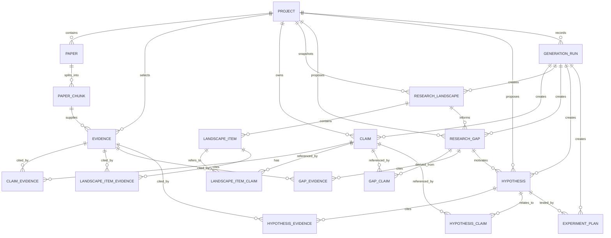
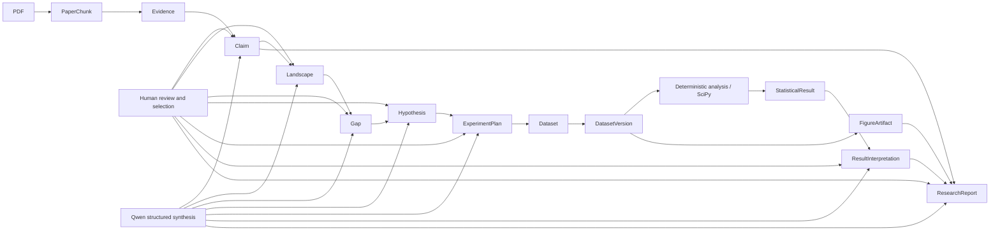

# 溯理 SULI MVP 初始架构设计

> 前端呈现更新：项目采用「研究手稿室」布局，以 `stage=literature|landscape|directions|experiment|report` 分阶段浏览。共享状态与已访问组件在项目内保持，后台读取使用请求序号与写操作失效边界，避免丢失草稿或覆盖新审核结果；页边来源保留 Evidence 原文与 PDF 物理页链。后端接口和科学权限不变。详见 [前端设计规范](superpowers/specs/2026-10-17-manuscript-ui-design.md)。

> Status: Accepted for MVP implementation
> Version: 1.0

## 1. 目标与范围

MVP 为每个研究项目提供完整路径：研究问题 → 上传 PDF → 按页解析和切块 → 向量检索 → 人工检查并选入 Evidence → 有证据关联的 Claim → ResearchLandscape 与冲突 → 候选 ResearchGap → 用户选择 → Hypothesis → 用户选择 → ExperimentPlan → 回溯到原始 PDF 页。演示目标是稳定处理 5–10 篇相关论文；设计容量以 5–20 篇为界，不为互联网规模预留复杂基础设施。

用户可以编辑研究问题、检查和拒绝建议、编辑生成内容。研究者负责判断相关性、研究空白和实验适当性。每个后续生成操作都是用户显式触发；不自动连续推进科学决策。

不纳入多智能体、GraphRAG、知识图谱、模型微调、全网论文发现、复杂认证与分布式任务系统。

## 2. 总体结构与数据流

```text
Next.js + TypeScript 工作区
    │ typed API client
    ▼
FastAPI 路由（验证、调用服务、映射响应）
    │
    ├─ 项目与论文服务 ─ PDF 解析 ─ 按页切块 ─ EmbeddingProvider
    ├─ RetrievalService ─ pgvector Top-K ─ RetrievalResult[]
    ├─ EvidenceService ─ 人工选择/校验出处 ─ Evidence[]
    └─ 推理服务 ─ LLMProvider(Qwen) ─ 结构校验 ─ 来源校验 ─ 持久化
                              │
                      PostgreSQL + pgvector
                              │
                        本地 PDF 文件存储
```

采用一个前端、一个后端、一个 PostgreSQL 实例和本地受控 PDF 存储。后端统一采用同步数据库访问；逐篇论文的解析与索引由显式请求完成，并设置文件大小、页数和请求时限。前端可顺序触发各论文索引并展示状态。这样便于定位失败论文和重试，代价是单篇索引期间请求较长；超出受控演示规模时再评估持久任务队列。

### 2.1 固定流水线与检查点

1. `Project` 保存研究问题及其修订号。上传 PDF 后先保留原文件，再按页抽取文本和可置信的章节名；空文本、严重乱码或解析失败显式标记。`page_number` 指 PDF 阅读器中的物理页序，从 1 起，不冒充论文印刷页码。
2. `PaperChunk` 只覆盖单一 PDF 页，按句子边界切分，保留页码、页内序号、文本和可选章节；配置控制块大小及重叠。解析通过条件更新原子认领 Paper，并记录 `parse_started_at`；未过期的 `parsing` 拒绝重入，超过可配置阈值的中断解析可重新认领。恢复时在同一事务中清除旧 Chunk 并保存新 Chunk，失败时清除孤儿 Chunk，原 PDF 保留。抽取和 Chunk 持久化完成后 Paper 状态为 `parsed`。M2 嵌入以条件更新原子认领 `parsed`/`embedding_failed`、旧模型 `indexed` 或过期 `embedding`，记录 `embedding_started_at`；NULL 时间戳不自动过期。外部 provider 调用前释放数据库连接；全部向量验证通过后，短事务原子保存向量与 `indexed` 状态。失败设为 `embedding_failed`，保留原 PDF、Chunk 和 Evidence。
3. 检索把研究问题转为向量，在当前项目的已索引 Chunk 中 Top-K 搜索，直接返回非持久化的 `RetrievalResult[]`。前端可暂存候选列表供用户检查；它不直接写入 Evidence，也不调用 LLM。
4. 用户检查候选片段，显式选入 Evidence；前端提交 `paper_chunk_id` 和所选 `source_text`，后端检查原文确实出现在该 Chunk 内并自行定位。用户可撤销选用。证据创建后固定其原文和出处，前端不传文本偏移。
5. 生成 Claim 时只向 LLM 提供当前项目已选 Evidence 的真实 ID、原文和出处。输出经结构与 ID 校验后才保存。Claim 可以同时关联支持和质疑证据。
6. 用户明确判断 Claim 依据并选择后，Landscape 仅汇总当前已审核且已选择的 Claim、方法、数据集、指标与冲突；生成 Landscape 默认待人工审核，研究者接受后才可供未来 Gap 阶段使用。Gap/Hypothesis/ExperimentPlan 尚未在 M3 实现。
7. UI 的每个重要科学陈述显示证据状态及可点击出处。由 Claim 到 Evidence，再到 PaperChunk、Paper、PDF 页的路径始终存在。实验计划经 Hypothesis、Gap 和 Evidence 回溯。

生成输入只使用同一项目、当前研究问题修订下的已选 Evidence、已选 Claim 和用户显式指定的有效下游对象。旧对象始终可查看；研究问题变更、人工修订或撤销选择不会改写既有生成结果。新一轮生成在入口沿现有来源关系读取并校验当前修订、未被替代的版本及所需上游选择状态，不符合条件则拒绝并说明原因；不向旧行级联写入失效标志。生成内容的人工编辑创建新版本，保留旧对象及其证据链接。

## 3. 基础领域模型与不变量

| 对象 | 关键字段 | 含义与约束 |
|---|---|---|
| Project | `id`, `title`, `research_question`, `question_revision`, `status`, 时间戳 | 一个研究调查；问题编辑使修订号递增。 |
| Paper | `id`, `project_id`, `title?`, `source_filename`, `storage_key`, `parse_status`, `quality_note?`, `created_at` | 原始 PDF 及处理状态。未可靠识别标题时显示文件名，不能伪造文献题名。 |
| PaperChunk | `id`, `paper_id`, `page_number`, `chunk_index`, `section?`, `text`, `embedding?`, `embedding_model?`, `embedding_dimension?` | 检索单元；页码来自实际 PDF 页，页内序号唯一；一块不跨页。向量和模型/维度元数据同时存在或同时为空。 |
| RetrievalResult | `chunk_id`, `paper_id`, `page_number`, `section?`, `text`, `similarity_score` | 非持久化候选结果；只表示相关性，不表示科学支持。 |
| Evidence | `id`, `project_id`, `paper_chunk_id`, `source_text`, `evidence_type`, `relevance_note?`, `selection_status`, `question_revision` | 已选用于推理的原文片段。创建时后端检查 `source_text` 是 Chunk 原文的非空子串；可在服务端记录定位信息，不要求前端传偏移。出处由 Chunk→Paper→PDF 页解析。 |
| Claim | `id`, `project_id`, `text`, `claim_type`, `ai_grounding_assessment?`, `ai_risk_flags?`, `ai_justification?`, `ai_evidence_refs?`, `ai_support_excerpts?`, `human_grounding_status`, `human_reviewed_at?`, `confidence?`, `uncertainty`, `question_revision`, `selection_status`, `origin`, `supersedes_id?`, `generation_run_id?` | AI 核查是建议；人工判断初始 `pending_review`。只有人确认 `supported` 或 `inferred`，且显式选择、有真实来源、版本有效，才可进入 Landscape。历史 `legacy_grounding_status` 只供审计，不代表人工确认。 |
| ResearchLandscape | `id`, `project_id`, `summary`, `uncertainty`, `ai_summary_assessments?`, `review_status`, `reviewed_at?`, `question_revision`, `origin`, `supersedes_id?`, `generation_run_id?`, `created_at` | 结构化综述快照初始 `pending_review`；只有研究者显式 `accepted` 且上游仍有效时，才可作为后续科学阶段输入。接受仅表示认可这份工作性综合。 |
| LandscapeItem | `id`, `landscape_id`, `category`, `text`, `uncertainty`, `ai_conflict_assessment?` | 类别包含 approach、method、dataset、metric、finding、conflict。AI 冲突评估及来源保留供审计；条目类别和文字中的直接冲突主张须一致。 |
| ResearchGap | `id`, `project_id`, `landscape_id`, `title`, `description`, `gap_type`, `why_it_matters`, `uncertainty`, `assumptions`, `novelty_scope`, `ai_assessment?`, `selection_status`, `question_revision`, `origin`, `supersedes_id?`, `generation_run_id?` | 候选研究空白，`novelty_scope = supplied_literature`；通过 GapLandscapeItem/GapClaim/GapEvidence 关系保留来源，不能宣称全领域新颖。 |
| Hypothesis | `id`, `project_id`, `research_gap_id`, `statement`, `rationale`, `independent_variable`, `dependent_variable`, `control_variables`, `falsification_condition`, `assumptions`, `selection_status`, `question_revision`, `origin`, `supersedes_id?`, `generation_run_id?` | 候选可证伪假设。必须绑定当前项目已选择的 Gap。正向 Evidence 关系为 `motivates`，表示提出假设的依据而非已证明假设。 |
| ExperimentPlan | `id`, `hypothesis_id`, `objective`, `independent_variable`, `dependent_variable`, `control_variables`, `baseline`, `experimental_groups`, `dataset_requirements`, `metrics`, `procedure`, `analysis_approach`, `expected_observations`, `falsification_criteria`, `confounders`, `limitations`, `assumptions`, `uncertainty`, `ai_alignment_assessment?`, `review_status`, `reviewed_at?`, `question_revision`, `origin`, `supersedes_id?`, `generation_run_id?` | 初始研究计划，绑定所选 Hypothesis；AI 评估变量与假设的语义对齐供人工核查。生成后 `pending_review`，仅人工接受的当前版本具备未来下游资格。无 `selection_status`。 |
| GenerationRun | `id`, `project_id`, `stage`, `status`, `provider`, `model`, `prompt_name`, `prompt_version`, `prompt_hash`, `schema_version`, `research_question_snapshot`, `question_revision`, `input_manifest`, `input_digest`, `attempt_count`, `error_type?`, 时间戳 | 一次逻辑生成调用的轻量记录。输入清单只存经过校验的对象类型、ID 和内容摘要；输出通过生成对象的 `generation_run_id` 回连。失败运行也保留。 |

`selection_status` 用于 Evidence（`selected / rejected`）和 Claim、Gap、Hypothesis（`candidate / selected / rejected`）。Claim 的人工 grounding 判断是另一项独立决策。Landscape 与 ExperimentPlan 使用 `review_status`（`pending_review / accepted / rejected`）。科学内容、来源关系和 `question_revision` 创建后不改；人工编辑创建新行，`supersedes_id` 指向被修订行，每行最多被直接修订一次。Gap/Hypothesis 新版本重置为候选，Landscape/Plan 新版本重置为待审核。旧版本保留供历史查看，被替代版本不得作为新生成输入。资格字段由服务端根据当前问题修订、来源、上游人工判断和版本状态实时计算。生成对象以 `origin` 区分模型生成和人工修订。项目内跨实体引用必须同属一个 Project；模型只能引用当前修订中的真实来源。`confidence` 是主观等级，不冒充统计置信度。

五类生成科学对象的 `origin` 仅允许 `model / human_revision`。`origin = model` 时，`generation_run_id` 必填并指向已存在、`status = succeeded` 的 GenerationRun，且 Run 的 `project_id` 与对象所属项目一致、`stage` 与对象类型一致；MVP 中此类对象的 `supersedes_id` 为空。`origin = human_revision` 时，`supersedes_id` 必填、`generation_run_id` 必须为空；人工版本通过 `supersedes_id` 版本链追溯原模型运行，不冒称由该次模型调用直接生成。ExperimentPlan 的项目归属由其 Hypothesis 关系确定。

数据库在可行处用枚举/取值约束、外键、条件非空 `CHECK` 约束和 `supersedes_id` 唯一约束保证单行结构与真实引用。GenerationRun 的成功状态、stage 与对象类型匹配、跨表项目归属以及模型生成/人工修订的生命周期语义由服务/领域层校验，并在最终保存事务内复核；MVP 不为这些语义引入触发器或复杂数据库机制。

### 3.1 证据溯源及冲突

`ClaimEvidence(claim_id, evidence_id, role)` 的 `role` 为 `supports / challenges`，一个 Claim 可有多条两类证据。Evidence 的 `source_text` 必须从 Chunk 原文精确截取；服务端可保存首次匹配位置供定位，但客户端不传也不依赖位置。Chunk 的 `paper_id`、`page_number` 指向原 PDF。PDF 文件、被引用 Chunk 和 Evidence 在 MVP 中不可就地覆盖；删除含有下游引用的 Paper 应拒绝并说明关联关系。重传视为新 Paper。这样避免重解析、清理或编辑使已保存结论的出处漂移。

`GapClaim`、`GapEvidence(role: supports / challenges)`、`HypothesisEvidence(role: motivates / challenges)` 和 `HypothesisClaim(role: challenges / extends)` 保存下游解释路径。`motivates` 只表示证据启发待检验的假设，不声称证实假设。LandscapeItem 可以通过 `LandscapeItemClaim` / `LandscapeItemEvidence` 链接来源。联结表至少有复合唯一键和真实外键，数据库外键与服务层共同确保同项目、同修订。没有足够证据时返回显式 `insufficient_evidence`，不制造 Evidence ID、引用或研究结果。

### 3.2 数据库关系



页码是 `PaperChunk.page_number`，由原 PDF 真实页索引得到，不增加独立 Page 表。Evidence 可通过外键获取 Paper 标题和页码，避免在多处维护相互矛盾的来源字段；API 响应会展开这些字段。结构化列表如控制变量、实验组可用受验证的 JSONB 或子表；核心对象及其证据关联必须用关系表。`GenerationRun.input_manifest` 是经校验的诊断性 lineage JSONB，包含对象类型、ID、内容摘要和调用时选择状态；不取代 Claim→Evidence 等关系外键，也不存整篇 PDF 或原始 Prompt。模型生成对象用可空外键指向成功的 Run，人工修订版本用 `supersedes_id` 回溯模型版本。Chunk 的向量列与实际嵌入维度一致，并记录模型标识；更换维度须迁移或重建索引，不混用向量空间。所有 schema 变化走 Alembic。

M2 的生产嵌入空间为 DashScope 原生接口 `qwen3.7-text-embedding`、1024 维稠密向量；pgvector 列固定为 `vector(1024)`。文档索引用 `text_type=document`，查询用 `text_type=query` 和集中定义的科研论文段落检索指令（`backend/app/providers/embeddings.py`）；两者均显式请求 `dimension=1024`、`output_type=dense`。配置/provider 维度不符时明确失败，不裁剪或补齐向量。检索仅包含当前模型且 1024 维的已索引 Chunk；旧 `text-embedding-v4` 即使同维也不兼容。`/index` 仅在所有 Chunk 都属于当前嵌入空间时幂等；旧模型 Paper 原子认领为 `embedding`，复用 M1 Chunk 完整重嵌入，成功后整批替换向量并恢复 `indexed`，失败标记 `embedding_failed` 且旧向量不参与检索，Evidence 来源不变。检索使用精确余弦 Top-K，无 HNSW/IVFFlat、混合检索或默认相似度阈值。`RetrievalResult` 不落库，只有用户明确选中后才创建 Evidence。未来可单独基准比较 1024 与 2560 维；维度变化需显式数据库迁移和重建。

## 4. 服务边界

| 边界 | 职责与输出 | 不承担的职责 |
|---|---|---|
| ProjectService | 创建/编辑项目，维护问题修订；历史对象只读保留 | 科学推理或级联改写生成物 |
| PaperService + PDFService | 文件验证、受控存储、逐页提取、解析质量和状态 | 检索/生成 |
| ChunkingService | 句子感知、单页切块；输出可追溯 Chunk | 证据认定 |
| EmbeddingService | 调用 EmbeddingProvider、记录模型和失败 | 向量排序、Qwen 推理 |
| RetrievalService | 当前项目的查询向量与 pgvector Top-K；返回 RetrievalResult | Evidence 创建、LLM 调用 |
| EvidenceService | 人工选入/拒绝、服务端原文定位和项目一致性验证 | 自动把所有命中片段当证据 |
| ClaimService | 根据已选 Evidence 生成/修订/校验 Claim 和正反关系；管理用户选择 | 直接查询向量库 |
| ResearchLandscapeService | 生成结构化综述及冲突条目，保留来源引用 | 宣告哪方绝对正确 |
| ResearchGapService | 基于综述与证据提出候选 Gap，校验支持/质疑来源 | 断言全领域新颖性 |
| HypothesisService | 对用户所选 Gap 生成可证伪 Hypothesis | 自动选 Gap |
| ExperimentPlanService | 对用户所选 Hypothesis 生成初始计划 | 执行实验或报告结果 |
| GenerationRun 记录 | 记录每次生成的模型、Prompt 版本、问题快照、输入 ID/摘要、结果和失败类型 | 替代领域来源关系或保存完整私有文档 |
| LLMProvider / Qwen adapter | 模型选择、请求、有限重试、格式模式、超时、供应商错误映射 | 科学事实判定、数据库写入 |
| EmbeddingProvider / adapter | 批量文本与查询嵌入、模型/维度暴露、有限重试 | 检索排序与科学判断 |

服务只依赖明确接口。长 Prompt 集中在 `backend/app/prompts/` 并纳入版本控制；推理服务按下述 GenerationRun 生命周期执行，文件存储先用受控本地目录及存储键，不引入通用存储框架；确需替换时再抽象。

### 4.1 GenerationRun 事务生命周期

1. **阶段 0：输入预检查。** 创建 Run 前，校验项目存在、当前 `question_revision`、所引对象 ID、项目归属、选择状态、是否被替代、来源约束及最低证据/输入要求。预检查失败直接返回对应业务或校验错误，不创建 GenerationRun。
2. **阶段 1：保存 started Run。** 用一个短数据库事务创建 GenerationRun，写入 `status = started` 及已经校验的模型、Prompt、schema 和输入 lineage 元数据，然后提交。事务及数据库连接在外部 provider 调用前结束。
3. **阶段 2：调用 provider。** 在没有开放数据库事务或连接的情况下调用 Qwen/`LLMProvider`。生成、受限结构修复、Claim 语义核查、冲突核查、summary 核查及受限定向修复都属于同一逻辑 Run；`attempt_count` 累加实际 provider 请求次数。语义核查会增加推理延迟和成本，后续基准测量总时长与调用次数。
4. **阶段 3A：成功。** 先校验生成输出的结构、ID 白名单、证据出处及领域不变量，再由独立结构化语义核查判定 Claim 的最终 grounding；模型自报状态无权决定落库状态。`directly_supported`/`inferentially_supported`/`unsupported`/`contradicted`/`insufficient_evidence` 分别映射为 `supported`/`inferred`/`unsupported`/`unsupported`/`insufficient_evidence`。Claim 核查只返回 verdict、Evidence ID、风险标记和简短理由；直接支持须引用至少一条该 Claim 的支持 Evidence。服务端从当前项目、当前修订的已选 Evidence 及其 PaperChunk→Paper 关系取得原文和物理页，并在最终事务复核。Claim 展示用的 `ai_support_excerpts` 由这些持久化 Evidence 原文生成，不由核查模型返回。Landscape 的新版本核查仅返回授权 Evidence ID 与独立科学判断；服务端绑定已验证快照中完整 Evidence 原文，仍执行原精确子串校验。每条目独立判断 support_verdict（supported/unsupported/insufficient_evidence）、flagged_statements 与 qualifications，同时保留冲突与可比性核查。正向支持必须引用所引 Claim 的支持 Evidence；重复、越界、挑战来源冒充支持及未解决的支持缺陷均拒绝。只有核查为 `direct_conflict` 且比较维度不矛盾的候选冲突可保存为 `conflict`；summary 单独核查重大科学陈述。任一核查失败且受限修复仍无效时整批失败。最后用短事务复核等待期间可能变化的问题修订和选择状态，原子保存整批对象、来源关系和成功 Run。

ClaimVerification 是一次生成请求中的临时结构，不单独持久化；核查结果的 `verdict`、`risk_flags`、`justification`、`evidence_refs` 保存到 Claim 的 `ai_*` 字段供人工审核。旧契约的 `support_excerpts` 曾用于直接支持的结构校验、Evidence 原文精确子串校验、Claim 的 `ai_support_excerpts` 持久化及前端显示；后续科学对象使用 ClaimEvidence 关系，而不读取这些摘录。现行 provider JSON Schema 直接由 Pydantic ClaimVerification 生成，字段为 `verdict`、`evidence_refs`、`risk_flags`、`justification`。应用层仍校验项目归属、当前修订、已选输入白名单、直接支持的 Evidence 角色与重复 ID。`ai_support_excerpts` 由服务端从已保存 Evidence 原文生成，保持现有 API/数据库形状；旧记录按原样可读，不需要迁移或重写。

ClaimVerification 的风险契约区分 Claim 措辞超出 Evidence 的支持缺陷与 Evidence 本身的局限。`causal_amplification`、`statistical_significance_amplification`、`unsupported_comparison`、`unsupported_generalization`、`condition_population_loss`、`metric_mismatch`、`other_qualification_loss` 都指向前者，与 `directly_supported` 不兼容。`methodological_limitation`、`statistical_evidence_limitation`、`generalizability_limitation` 指向后者；仅在 Claim 文字仍处于 Evidence 的字面范围内时可与 `directly_supported` 并存。其余四种非直接支持 verdict 可保留任一风险标记；这并不提升 Claim 的科学权威。字面范围由独立的语义核查判断，应用层对 verdict 与 flags 执行确定性兼容矩阵和来源校验；矛盾组合进入一次受限核查修复，修复应调和 verdict 与 flags，不能只删除风险。仍不兼容时沿用 `structured_output_invalid` 外层错误，并在清洗后的诊断中记录 `direct_support_risk_flags`。全部候选核查完成后才在一次最终事务中保存 Claims 与成功 Run；生成的 Claim 仍为 `pending_review`。
5. **阶段 3B：失败。** provider 调用、返回后的校验或最终事务中的状态复核失败时，回滚未提交的生成对象，并用独立短数据库事务设置已存在 Run 的 `status = failed`、允许记录的 `error_type`、`completed_at` 和实际 `attempt_count`，再提交；不留下部分 Claim、ResearchLandscape、ResearchGap、Hypothesis 或 ExperimentPlan。

**事务不变量：失败的 GenerationRun 独立持久化；成功的 Run 与生成科学对象及来源关系原子提交；等待外部 LLM provider 时不保持数据库事务或连接开放。**

Landscape reference-only 核查使用 `LandscapeItemVerification` / `LandscapeSummaryVerification`，Prompt `m3-v5` 与 schema `m3-landscape-v4`。模型响应不接受 `support_excerpts`；这不是对旧错误引文的自动改写。新评估仍通过既有 JSON 字段提供 `support_excerpts`，但标明 `source_binding_origin=server_bound_canonical_source_text`、版本、source hash 与现有 PaperChunk/Paper/物理页出处。完整原文绑定只保证来源文字真实，不证明命题成立。summary 使用独立核查与已验证条目，正向判断也须引用当前范围的支持 Evidence。未知维度、未支持的效应/优越性/显著性/因果/全领域新颖性、虚构语料中的假实验冲突及丢失的重要条件必须拒绝或接受既有受限语义修复；仍失败不保存任何 Landscape。旧评估 JSON 和旧失败 Run 保持可读、不重写，无迁移和新公开端点。所有 AI 判断仅为建议，人工接受仍是 M4 的必要条件。

Landscape 最终事务在复核 Claim 来源状态后，锁定精确的原始 GenerationRun 并要求其仍为 `started`；保存 Landscape 与来源关系时，以带 `status = started` 条件的更新把同一 Run 转为 `succeeded`。已失败、过期恢复或失去执行权的 Run 不得提交 Landscape。Landscape 生成、冲突核查及修复、summary 核查及修复、来源复核和提交均记录脱敏阶段事件；事件只含 Run ID、阶段、调用轮次、HTTP/耗时、校验代码等元数据，不保存 Prompt 或科学正文。

`prompt_hash` 是对应 `prompt_version` 的完整静态 Prompt bundle 规范化 JSON 的 SHA-256；bundle 覆盖生成、结构修复、语义核查及定向修复指令。研究私有 Evidence 原文、动态上下文和凭据不纳入该摘要。人工修订沿现有契约由研究者填写 grounding 与来源，并需再次显式选择；模型语义核查不会擅自改写人的科学判断。人工修订的 grounding 是人工判断，不应解释成模型核查通过。

最小 provider 契约为 `LLMProvider.generate_structured(prompt, output_schema, context)` 与 `EmbeddingProvider.embed_documents(texts)` / `embed_query(text)`；后者还须报告模型标识和向量维度。接口返回数据或明确的超时、限流、无效输出错误，不直接写数据库。Qwen adapter 负责具体模型、认证和供应商参数，服务层负责科学来源校验。配置集中读取数据库 URL、Qwen 密钥与模型、embedding 模型、块大小/重叠、Top-K、上传大小/页数、超时和重试次数；实施时同步维护 `.env.example`，不提交真实密钥。

## 5. 结构化输出与失败策略

Qwen 返回视为不可信输入。对 Claim、Landscape/Item、Gap、Hypothesis、ExperimentPlan 定义版本化 Pydantic/JSON Schema：必填字段、类型、枚举、长度和非空约束固定；模型只可引用请求上下文白名单中的真实 Evidence/Claim/Gap ID，不能自造 ID。新对象的 ID 由服务端在通过校验后分配。服务再检查来源属于当前项目与修订、Landscape 输入 Claim 均为 `selected`、所需正向证据存在、正反角色不冲突、假设有变量与可证伪条件、实验计划有基线和指标。研究空白中的“缺失”只描述已上传资料的覆盖情况，不推断全领域无人研究。模型给出的页码、文献标题或引文不直接采信，响应由数据库来源展开。验证失败可进行一次受限修复重试；仍失败返回 `structured_output_invalid`，保留诊断而不存半成品。

“缺乏支持”是可见的业务状态：无可用证据时阻止生成并返回 `insufficient_evidence`；已有候选文本但支持不足时只能保存/展示为 `unsupported` 或 `inferred`，不可供 Gap/Hypothesis 自动推理使用。供应商超时、嵌入失败、解析失败、空检索、数据库故障均有不同错误码和可见状态。记录 request_id、project_id、paper_id、stage、provider、耗时和错误类型；不记录密钥或整篇私有论文。重试有次数/超时上限。

## 6. 仓库目录结构规划

以下为未来实施时的规划，当前任务不创建应用目录或业务代码。

```text
AGENTS.md
docs/
  product-spec.md          # 产品范围原文
  architecture.md          # 本设计
  api-design.md            # API 契约
backend/
  app/
    api/                   # 薄路由及请求/响应映射
    domain/                # 核心模型、枚举、不变量、版本关系
    services/              # 解析、检索、证据、推理阶段
    providers/             # Qwen/Embedding 适配器及接口
    prompts/               # 版本化 Prompt
    persistence/           # SQLAlchemy 模型、仓储
    config/                # 环境配置
  alembic/                 # 数据库迁移
  tests/                   # 领域、服务、API 与端到端测试
frontend/
  src/
    app/                   # 项目工作区与页面
    components/            # 证据卡、Claim、Gap、Hypothesis 等
    lib/api/               # 类型化 API 客户端
  tests/
.env.example               # 未来实施时维护，无密钥
README.md
```

这个目录只表示职责位置，不要求预先创建同名空模块。前端以项目工作区、论文列表、检索候选、证据/Claim 卡、冲突、Gap、Hypothesis、ExperimentPlan 为主，来源页链接直接可见。

## 7. 核心决策与取舍

### 隔离评审提案：Landscape v9 判断上下文

`m3-v10 / m3-landscape-v9` 仅在隔离原型中将 item 判断上下文编码为版本化、固定列数组。公开 provider schema、完整 canonical 存储、API 和历史读取不变。2500 仍为上限，但度量变为 `len(str(actual encoded payload))`，不可与 v8 verbose 数字直接比较。当前候选、已接受的本轮判断、后续预留、角色/列表开销和真实 summary payload 共用编码器。科学验证和来源权限不变；critique 1500、批准范围 output 4627、context 30000 不变。本文档不授权部署。详见 [表示契约](landscape-assessment-representation-2026-10-12.md)。

| 决策 | 收益 | 代价/边界 |
|---|---|---|
| 单体 FastAPI + 明确服务流水线 | 部署、调试和演示简单；阶段失败易定位 | 单机吞吐有限，符合 5–20 篇论文目标 |
| PostgreSQL 关系模型 + pgvector | 来源关联可用外键检查；检索与领域数据同库 | 需管理向量维度和迁移；不为大规模检索优化 |
| Chunk 与 Evidence 分离，人工选入 | 避免相关片段直接变成科学证据 | 多一次用户操作，符合研究者控制原则 |
| 人工确认依据且 selected 的 Claim 才进入 Landscape | 研究者先判断科学陈述是否受当前证据支持，再选择输入 | 增加两项显式决策 |
| 检索服务不调用 LLM | 可分别评估召回与推理错误 | 应用服务需显式传递检索和证据上下文 |
| Evidence 原文和 Chunk/PDF 固定；前端只提交片段文本 | 保存历史 Claim 的可验证出处，避免跨语言偏移换算 | 相同片段重复出现时由服务端固定首次匹配位置；修正解析需重传新 Paper |
| Qwen/Embedding 最小 provider 接口 | 模型可配置、易模拟测试，业务无 SDK 耦合 | 保留少量接口/适配代码，不做通用模型市场 |
| 严格结构与引用校验 | 阻止假 ID、假引文和失配字段落库 | 可能拒绝部分自然语言上可用的输出；可见失败优于假确定性 |
| 用户分段触发生成 | 保留科研判断与审查机会 | 点击次数增加；符合产品交互目标 |
| 逐篇同步索引 + 有界重试 | 无隐式后台状态，演示可重复 | 单篇请求较慢；大论文受上传/页数上限约束 |
| 生成内容不可就地改写；修订生成新版本 | 历史来源和输入不漂移，无逐层 stale 更新 | 多保留一些历史行；生成入口需检查当前版本与选择状态 |
| Hypothesis 的正向 Evidence 用 `motivates` | 避免把待检验假设表述为已获证实 | 与 Claim/Gap 的 `supports` 角色不同，API 需分别建模 |
| Landscape 有独立人工审核状态 | 接受工作性综合后才可供未来 Gap 阶段引用 | M3 无实际下游消费者；仅提供资格判定 |
| GenerationRun 保存轻量输入 lineage | 能定位模型、Prompt、输出 schema、输入版本和失败，便于复现演示 | 增加一张表及简短清单；不保存原始 Prompt/全文，不能单凭 Run 重建外部模型行为 |

## 8. MVP 开发里程碑

| 阶段 | 可验收产物 | 关键验证门槛 |
|---|---|---|
| M0 契约与环境 | 认可本架构/API、配置模板、数据库迁移起点、最小 UI 骨架 | 契约和错误码一致；无密钥入库 |
| M1 项目与论文 | 项目问题编辑、PDF 上传/按页解析、单页切块、质量状态 | 真实 PDF 页码可回到原文件；失败不伪装成功 |
| M2 索引与证据 | 嵌入抽象、pgvector Top-K、RetrievalResult、人工选入 Evidence | Chunk→Paper→页和 Evidence 原文校验；检索失败独立可诊断 |
| M3 Claim 与 Landscape | Qwen 抽象、GenerationRun、结构化 Claim、用户选 Claim、综述和冲突展示 | 仅 selected Claim 进入 Landscape；假 ID/错项目输出被拒绝 |
| M4 Gap → Hypothesis → Plan | 候选 Gap、用户选取、多个可证伪假设、用户选取、初始实验计划 | 结构字段齐全；来源链不断；未选择不得越级生成 |
| M5 数据分析 | 不可变 CSV 版本、人工审核清洗与分析方案、确定性统计与图表、人工审核解释 | 原始文件/数值来源可追溯；模型不得计算统计值；失败不产生有效结果 |
| M6 报告与演示 | 最终报告、提交打包、基准比较与演示加固 | 基于真实测量与已审核 M5 产物，不伪造效率提升 |

每阶段用确定性 mock 验证 provider 和输出校验，PDF、切块、来源关联、检索及 API 契约分别测试；真实 Qwen 调用仅作为受控集成/演示检查，不成为常规测试套件前提。里程碑按可演示纵向切片验收，暂不指定工期。

## 9. 核心技术风险与缓解

| 风险 | 缓解与演示检查 |
|---|---|
| 扫描版/复杂排版 PDF 无可靠文本或页码 | 对空页、低文本量、异常字符做质量检查并标记 `parse_failed`/`low_quality`；演示先选有文本层的论文，不虚构 OCR 结果。 |
| 跨页或截断切块造成错误出处 | 每块限单页并按句子边界切分；服务端检查 Evidence 原文出现在 Chunk 内并保存定位。 |
| 模型捏造 Evidence ID、页码或来源 | 仅给真实 ID 白名单；引用逐项校验；标题页码由数据库展开，错误输出拒绝保存。 |
| 检索相关性不足导致貌似有理的推理 | Top-K/得分和原文可视化；人工选入证据；无相关证据即停止生成并提示不足。 |
| 不同论文结果看似矛盾但条件不同 | Claim 保存正反 Evidence；冲突条目保留条件和不确定性，交由研究者判断。 |
| Embedding 模型变更或向量维度不符 | 配置固定模型，记录每条向量模型标识；不混合模型索引；切换时显式重建。 |
| Qwen/Embedding 延迟、限流或不可用 | 分阶段调用、短次数重试、超时和准确错误码；保留已完成阶段，可从失败阶段重试。 |
| 研究问题或论文变化让旧输出失去语境 | 旧对象和其问题修订保留；生成入口拒绝跨修订/被替代版本或撤销选择的上游输入；被引用论文不可静默覆盖/删除。 |
| 生成诊断无法复现输入 | GenerationRun 记录模型、Prompt 名称/版本/摘要、研究问题快照与输入 ID/摘要，且不代替领域外键。 |
| 演示过程中单篇索引超时 | 上传大小和页数上限、逐篇处理、预先验证 5–10 篇演示语料、展示每篇状态。 |
| 密钥泄露或恶意上传 | 环境变量和 `.env.example`、PDF 类型及大小验证、存储键隔离、路径净化、错误响应不暴露栈。 |

## 10. 审核关注点

M4 沿用 M3 的 `qwen3.8-max` 默认模型、严格 JSON Schema、短事务 GenerationRun 和人工科学授权边界。Gap 只能来自当前人工接受的 Landscape；Hypothesis 只能来自人工选择的 Gap；Plan 只能来自人工选择的 Hypothesis，生成后需人工接受。AI 评估作为建议持久化，不自动推进状态。M4 到人工接受的实验计划为止，不执行实验或分析结果。

M4 Gate 修复后，Gap 的 `evidence_for_ids` 至少有一条经过当前项目、当前来源上下文和 Claim/Landscape 关系校验的支持证据；`evidence_against_ids` 可以为空。模型输出与人工修订均受此约束，结构修复不得凭空补来源。已执行过 `0007` 的数据库须先升级到 `0008_m4_gate_fixes`，再回退至 M3；`0008` 回退会按外键顺序删除 M4 对象及其 `gap`、`hypothesis`、`experiment_plan` GenerationRun，保留 M3 对象和运行记录。直接从旧 `0007` 回退仍会遇到历史迁移约束错误。

## 11. M5 数据分析边界

M5 延续当前 M4 的人工科学授权链。`Dataset` 只能连接当前有效且已接受的 ExperimentPlan。原始 CSV 与衍生版本使用服务端 UUID 路径、SHA-256、父版本及 CleaningRun 关系；新版本从不覆盖原始文件。CSV 解析与画像在事务外进行，文件持久化失败或最终状态复查失败会清理新产物。执行记录先以 `started` 提交；确定性计算结束后，结果与 `succeeded` 在一个事务内写入，失败则单独写入 `failed`。分析结果与图表引用精确的数据版本和执行方法。

清洗、统计和绘图分别由 `m5_data.py`、`m5_stats.py`、`m5_figures.py` 中的白名单函数执行。无任意 Python、SQL、shell 或模型生成代码执行。`M5Service` 管理数据、清洗、分析和图表；`M5AIService` 通过现有 LLMProvider、GenerationRun 与版本化 Prompt 处理建议和解释。Qwen 接收有界结构化元数据、已计算数值及来源 ID，不接收完整原始行。画像中的分类值源自 CSV 单元格，每列最多 10 个、每值最多 100 字符，仍须按不可信文本处理。静态提示束包含生成、修复及解释评估文本。模型输出通过 Pydantic、来源白名单、当前状态复查和文字过度结论校验后，仍只得到 `pending_review`。数值卡片只读 StatisticalResult。

**LLM does not calculate statistical results. Computed statistics are produced by deterministic code from immutable dataset versions. AI interpretation is advisory until human reviewed.** 历史 M5 对象可读；当前报告资格必须重新穿过 M4 的当前已接受 Plan。迁移 `0009_m5_data_analysis` 仅新增 M5 表与 GenerationRun 的实际模型阶段；回退先删除 M5 表和 M5-only GenerationRun，再恢复 M4 阶段约束。

## 12. M6 报告交付层

M5提供人工明确确认的永久图表删除命令：服务锁定项目和图对象，受控存储仅允许删除figures目录内PNG，再删除FigureArtifact行。文件删除失败不提交行删除；数据库提交失败则明确报告文件已删、需重试清理，允许幂等处理已不存在的文件。VisualizationSpec执行记录、原始数据及StatisticalResult保留。解释/报告通过原有完整图表集合和来源资格复查变为非当前；不就地改写已审核来源快照，也不自动重算或自动接受重建输出。此操作是用户明确要求的不可恢复清除，区别于生成失败/修订时的默认历史保留。

Landscape 的 post-M6 可靠性增强使用请求局部的累计生成预算，保留 30,000 字符 guard、完整 Claim/Evidence 原文和独立科学核查。正常生成、全部 item assessments、语义修复和修复后再核查均按 Python `len(str(payload))` 限额拒绝，不截断来源或资格条件。summary prompt 仅移除重复的文献元数据；持久化仍绑定完整 canonical source 与物理页出处。预算失败保留失败 Run，不保存部分 Landscape；历史对象和旧 Run 保持可读。详细契约见 [landscape-context-budget-2026-10-09.md](landscape-context-budget-2026-10-09.md)。这不属于原始 `m6-pass` 功能冻结基线。

M6 使用 `M6ReportService` 复用 M3/M4/M5 当前资格检查。已接受的 ResultInterpretation、完整 StatisticalResult 集合、真实 FigureArtifact、DatasetVersion/AnalysisRun、实验计划、假设、空白、全景、Claim/Evidence/PaperChunk/Paper 形成确定性 Report Source Bundle，并以规范 JSON 计算 SHA-256。短事务保存 `research_report` GenerationRun；Qwen 调用在事务外；返回后重建并比较来源哈希，校验 Pydantic 结构、服务器分配的来源令牌、数字和越界措辞，再原子保存待审报告与成功 Run。来源变化则只保存失败 Run，不保存过期报告。

报告表保存不可变来源快照、哈希与叙述块。来源集合（包括 LandscapeItem）在哈希前按稳定 ID 排序；实验计划中有科学含义的组别顺序保持原样。Qwen 只写叙述与白名单 `source_refs`，叙述中的来源令牌和不受支持的绝对零效应表述会被拒绝；可见令牌、对象身份和证据页来自保存的来源快照并由导出器确定性呈现。人工修订新建 `human_revision` 版本并重置审核；当前且已接受的版本才能最终导出。Markdown/HTML 导出不调用 Qwen，统计结果从 StatisticalResult 快照确定性渲染，图像使用 FigureArtifact 受控端点。旧版本可读，来源状态在读取时重新计算。`0010_m6_report_delivery` 增加报告表和 GenerationRun 阶段；回退时先删除 M6 报告与 M6 Run。

报告生成采用三层时间界限。HTTPX 的 connect/read/write/pool 超时限制网络阶段及读空闲时间；每次 Qwen 尝试另由可取消的异步 HTTP 请求和单调时钟绝对期限限制完整请求与响应体，默认 60 秒，持续缓慢传输也不能延长尝试。当前最多两轮结构化输出（初次及一次校验修复），每轮最多 `RETRY_COUNT + 1 = 3` 次尝试，无重试 sleep/backoff，因此 provider 上限为 `2 × 3 × 60 = 360` 秒。报告从入口开始以单调时钟计算 390 秒硬期限（360 秒 provider 上限 + 30 秒应用预算）；超期后该 GenerationRun 不得提交报告，失败状态与来源关系保持原子性。前端报告请求期限为 420 秒，普通请求为 240 秒；活动 Run 在 450 秒后才可作为遗留运行恢复，默认顺序为 `390 < 420 < 450`。浏览器超时后仍活动的 Run 返回 409；遗留恢复在项目锁内原子地将旧 Run 标为失败并创建新 Run。最终事务在同一项目锁下锁定原 Run，要求其仍为 `started`、硬期限未到且来源哈希/当前资格有效，再条件性转为 `succeeded` 并提交报告。旧 worker 即使随后返回，也不能把失败 Run 重新标为成功。调整 provider 超时、重试次数或结构修复轮次时须重新核对三项期限和前端期限。数据库或进程级故障仍可能延迟 HTTP 响应；硬期限约束报告提交资格，不是操作系统级请求中断。



基准测量是版本化场景与独立的人工计时记录；仅当人工和 溯理会话同场景、同输入哈希且都完成时计算时间差。预检只读取配置、数据库/迁移/pgvector、受控存储写入能力与匿名化网络状态；可显式执行一次微型 provider smoke。统计正确性测试和人工语义评估分别报告，不混成单一质量分数。


### Corrected Landscape scope capacity follow-up (post-M6)

Landscape summary verification/repair now uses reversible ID-keyed maps for full exact Claim propositions, uncertainty, human grounding, support/challenge roles and canonical Evidence text. Generation/item verification and persisted provenance keep complete source objects. The shared summary-source builder is used both for budget calculation and actual guarded contexts. Output allowance is the minimum of the full-union item envelope, summary envelope with unchanged assessment/critique reservations, and existing output maximum. The subsequent prompt `m3-v8` / Run contract `m3-landscape-v7` adds request-local provider schemas enforcing the same cumulative Python representation budget before and after normalization, with numeric excess feedback for bounded repairs. Public and historical schemas, scientific support gates and human review remain unchanged. See the corrected-scope section of `landscape-context-budget-2026-10-09.md` and [the response-contract follow-up](landscape-response-contract-2026-10-10.md).
# Proposed assessment allocation follow-up

The review-only `m3-v9` Landscape prompt / `m3-landscape-v8` contract adds actual-prior measurement, future item/reference/role reservations and equal remaining slack shares under the unchanged 2,500 cumulative assessment cap. Structured repair receives current-only numeric guidance and the same quota; scientific reverification recalculates from a fresh assessment list. No public model, source-binding criterion, retry/repair fence or persistence boundary changes. See [the allocation contract](landscape-assessment-allocation-2026-10-11.md) for accounting and limitations; this proposal is not deployed.
